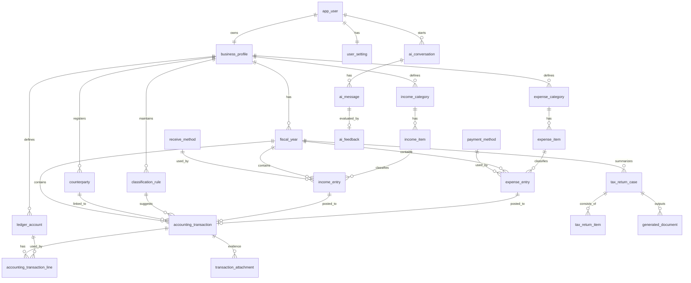

# DB設計案

## 前提

- 個人利用を前提に、1ユーザー = 1事業者の構成を基本とする。
- 12画面（ログイン、ユーザー登録、ホーム、確定申告、収益登録、支出登録、損益一覧、損益詳細、損益レポート、損益詳細レポート、設定、AIアシスタント）の表示/入力項目を反映する。
- `screen-03-tax-return` は入力画面ではなく、集計結果と申告関連データの参照画面として扱う。
- 入力系（収益/支出）と会計仕訳系（取引ヘッダ/明細）を分離し、監査可能性を担保する。

## テーブル構成

| テーブル | 役割 | 主な内容 |
| --- | --- | --- |
| `app_user` | ログイン主体 | ログインID、メール、パスワードハッシュ、表示名、状態 |
| `user_setting` | ユーザー設定 | 家事按分率、通知設定などのユーザー単位設定 |
| `business_profile` | 事業者設定 | 屋号、住所、申告方式、帳簿方式、届出番号 |
| `fiscal_year` | 申告年度 | 年度、対象期間、締め状態 |
| `income_category` | 収益区分マスタ | 売上/雑収入などの区分 |
| `income_item` | 収益項目マスタ | 区分配下の項目 |
| `expense_category` | 支出区分マスタ | 経費/仕入などの区分 |
| `expense_item` | 支出項目マスタ | 区分配下の項目 |
| `receive_method` | 受取方法マスタ | 現金、振込など |
| `payment_method` | 支払方法マスタ | 現金、振込、カードなど |
| `income_entry` | 収益登録データ | 区分、項目、日付、金額、申告対象外、詳細 |
| `expense_entry` | 支出登録データ | 区分、項目、日付、金額、申告対象外、家事按分、詳細 |
| `ledger_account` | 勘定科目 | 勘定科目コード、種別、申告区分 |
| `counterparty` | 取引先 | 顧客、仕入先、金融機関、メモ |
| `classification_rule` | 自動仕分け規則 | キーワード、取引先、勘定科目割当 |
| `accounting_transaction` | 取引ヘッダ | 日付、摘要、金額、入力元、状態 |
| `accounting_transaction_line` | 仕訳明細 | 借方貸方、勘定科目、金額、税区分 |
| `transaction_attachment` | 証憑 | 画像、PDF、保存先、ハッシュ値 |
| `tax_return_case` | 申告ドラフト | 年度、青色申告区分、集計結果、前年比、確定状態 |
| `tax_return_item` | 申告項目 | 画面表示用の項目値、順序、算定根拠 |
| `generated_document` | 帳票出力 | 申告書、決算書、レポート、出力ファイル |
| `ai_conversation` | AI会話セッション | 会話開始/終了、状態、トークン集計 |
| `ai_message` | AI会話メッセージ | user/assistantの発話本文、メタ情報 |
| `ai_feedback` | AI回答評価 | 回答への評価、コメント |

### テーブルの考え方

- `income_entry` / `expense_entry` は画面入力の事実を保持する。
- `accounting_transaction` / `accounting_transaction_line` は複式簿記の仕訳根拠を保持する。
- `tax_return_case` と `tax_return_item` は確定申告画面・帳票出力の集計スナップショットを保持する。
- `ai_conversation` と `ai_message` はAIアシスタント画面の履歴・追跡性を担保する。

## ER図

## 主要テーブル設計

### app_user

- `id`
- `login_id`
- `email`
- `password_hash`
- `display_name`
- `status`
- `created_at`
- `updated_at`

### user_setting

- `id`
- `app_user_id`
- `home_apportionment_rate`
- `created_at`
- `updated_at`

### business_profile

- `id`
- `app_user_id`
- `business_name`
- `address`
- `tax_office_name`
- `filing_type`
- `bookkeeping_method`
- `tax_notification_number`
- `start_date`
- `end_date`
- `created_at`
- `updated_at`

### fiscal_year

- `id`
- `business_profile_id`
- `tax_year`
- `period_start`
- `period_end`
- `status`
- `closed_at`
- `created_at`
- `updated_at`

### income_category

- `id`
- `business_profile_id`
- `category_code`
- `category_name`
- `is_active`
- `created_at`
- `updated_at`

### income_item

- `id`
- `income_category_id`
- `item_code`
- `item_name`
- `is_active`
- `created_at`
- `updated_at`

### expense_category

- `id`
- `business_profile_id`
- `category_code`
- `category_name`
- `is_active`
- `created_at`
- `updated_at`

### expense_item

- `id`
- `expense_category_id`
- `item_code`
- `item_name`
- `is_active`
- `created_at`
- `updated_at`

### receive_method

- `id`
- `method_code`
- `method_name`
- `is_active`
- `created_at`
- `updated_at`

### payment_method

- `id`
- `method_code`
- `method_name`
- `is_active`
- `created_at`
- `updated_at`

### income_entry

- `id`
- `fiscal_year_id`
- `income_item_id`
- `receive_method_id`
- `transaction_date`
- `amount`
- `exclude_from_return`
- `details`
- `created_at`
- `updated_at`

### expense_entry

- `id`
- `fiscal_year_id`
- `expense_item_id`
- `payment_method_id`
- `transaction_date`
- `amount`
- `exclude_from_return`
- `home_apportionment_rate`
- `deductible_amount`
- `details`
- `created_at`
- `updated_at`

### accounting_transaction

- `id`
- `fiscal_year_id`
- `counterparty_id`
- `classification_rule_id`
- `source_type` (`income_entry` / `expense_entry`)
- `source_id`
- `transaction_date`
- `transaction_type`
- `summary`
- `total_amount`
- `reconciliation_status`
- `status`
- `created_at`
- `updated_at`

### accounting_transaction_line

- `id`
- `accounting_transaction_id`
- `line_no`
- `ledger_account_id`
- `side`
- `amount`
- `tax_category`
- `memo`
- `created_at`
- `updated_at`

### transaction_attachment

- `id`
- `accounting_transaction_id`
- `file_name`
- `storage_path`
- `mime_type`
- `file_hash`
- `captured_at`
- `created_at`
- `updated_at`

### classification_rule

- `id`
- `business_profile_id`
- `rule_name`
- `match_type`
- `match_value`
- `ledger_account_id`
- `priority`
- `enabled`
- `created_at`
- `updated_at`

### tax_return_case

- `id`
- `fiscal_year_id`
- `revision_no`
- `blue_return_type`
- `calculation_basis`
- `status`
- `gross_sales_amount`
- `necessary_expense_amount`
- `business_income_amount`
- `blue_deduction_amount`
- `taxable_income_amount`
- `prior_year_sales_amount`
- `prior_year_expense_amount`
- `calculated_at`
- `created_at`
- `updated_at`

### tax_return_item

- `id`
- `tax_return_case_id`
- `item_code`
- `item_name`
- `display_order`
- `amount`
- `source_formula`
- `memo`
- `created_at`
- `updated_at`

### generated_document

- `id`
- `tax_return_case_id`
- `document_type`
- `file_name`
- `storage_path`
- `mime_type`
- `file_hash`
- `generated_at`
- `created_at`
- `updated_at`

### ai_conversation

- `id`
- `app_user_id`
- `fiscal_year_id`
- `status`
- `started_at`
- `ended_at`
- `total_message_count`
- `total_token_count`
- `created_at`
- `updated_at`

### ai_message

- `id`
- `ai_conversation_id`
- `role` (`user` / `assistant`)
- `message_text`
- `token_count`
- `created_at`

### ai_feedback

- `id`
- `ai_message_id`
- `rating`
- `comment`
- `created_at`

## 推奨ユニーク制約・索引

- `app_user.login_id` UNIQUE
- `app_user.email` UNIQUE
- `business_profile.app_user_id` UNIQUE
- `fiscal_year.business_profile_id, tax_year` UNIQUE
- `income_category.business_profile_id, category_code` UNIQUE
- `income_item.income_category_id, item_code` UNIQUE
- `expense_category.business_profile_id, category_code` UNIQUE
- `expense_item.expense_category_id, item_code` UNIQUE
- `ledger_account.business_profile_id, account_code` UNIQUE
- `income_entry.fiscal_year_id, transaction_date`
- `expense_entry.fiscal_year_id, transaction_date`
- `accounting_transaction.source_type, accounting_transaction.source_id` INDEX
- `accounting_transaction_line.accounting_transaction_id, line_no` UNIQUE
- `tax_return_case.fiscal_year_id, revision_no` UNIQUE
- `tax_return_item.tax_return_case_id, item_code` UNIQUE
- `generated_document.tax_return_case_id, document_type` UNIQUE
- `ai_message.ai_conversation_id, created_at`

## 補足

- 収益/支出登録は画面要件に合わせて `income_entry` / `expense_entry` を直接保持し、必要時に仕訳テーブルへ転記する。
- レポート（画面08/09）は原則 `income_entry` / `expense_entry` から集計し、申告系は `tax_return_case` / `tax_return_item` を参照する。
- AI画面の会話履歴は機密データを含み得るため、保持期間・マスキング・アクセス制御は運用ルールに従って実装する。
